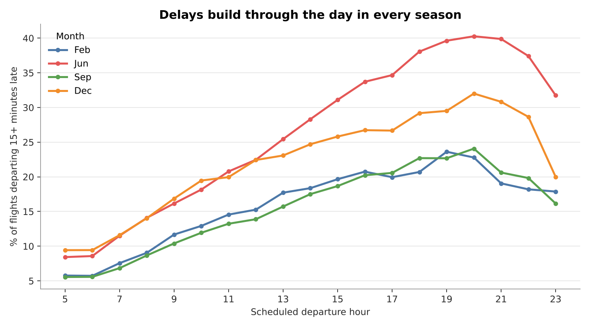
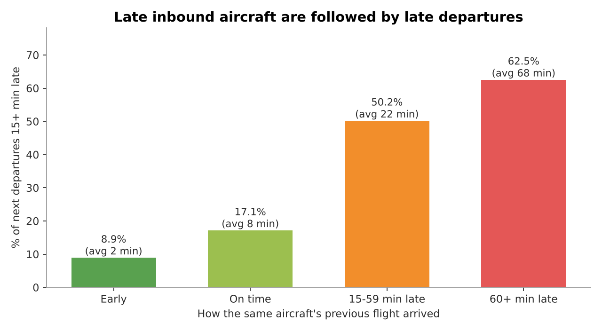

# Operational Drivers of Airline Departure Delays

**A four-season analysis of 2.3 million US domestic flights, with predictive modelling and an interactive Power BI dashboard.**

A reproducible analytics project using public data from the US Department of Transportation's Bureau of Transportation Statistics (BTS). It examines when and where airline delays occur, how delays propagate between consecutive flights operated by the same aircraft, and how accurately a departure delay can be predicted one hour before scheduled departure.

**Author:** Bhagyaprasad Vastrad  
**Tools:** Python · pandas · NumPy · scikit-learn · DuckDB · SQL · Power BI · DAX

---

## At a glance

| Flights analysed | Months | Carriers | Airports | Routes | Field values processed |
|---:|---:|---:|---:|---:|---:|
| **2,303,556** | 4 | 15 | 346 | 6,584 | ~80.6 million |

The analysis uses February, June, September and December 2024, with one month selected from each quarter to represent all four seasons.

## Executive findings

| Finding | Result |
|---|---:|
| Completed flights arriving on time | **80.46%** |
| Non-cancelled flights departing 15+ minutes late | **19.55%** |
| Flights cancelled | **0.80%** (18,528 flights) |
| Average departure delay | **11.3 minutes** |
| Delay minutes attributed to late-arriving aircraft | **39.8%** |
| Gradient boosting ROC-AUC on held-out December data | **0.764** |
| Gradient boosting PR-AUC on held-out December data | **0.516** |

### 1. Seasonality matters

On-time arrival ranged from **75.1% in June** to **84.5% in September**. Average departure delay in June was 16.9 minutes, around 2.5 times September's 6.6 minutes. These are monthly snapshots, so seasonal differences also reflect the specific weather and events of each month.

### 2. Delays build throughout the day

In every sampled month, late departures increased from the early morning towards an evening peak. The 8 pm late-departure rate was **3.4 to 4.8 times** the 5 am rate. Sunday evening (6 pm–11 pm) was the worst combined day-and-time slot at **33.1%** late; Wednesday morning was among the best at **11.0%**.

### 3. Late-arriving aircraft are the largest reported source of delay minutes

Late-arriving aircraft accounted for **39.8%** of delay minutes, followed by carrier causes (35.4%), the national airspace system (18.5%), weather (6.1%) and security (0.2%).

When an aircraft's previous flight arrived 15–59 minutes late, the next departure was late **50.2%** of the time. When the previous flight arrived early, that rate was **8.9%**. This is an association; shared operating conditions can contribute to both flights' delays.

### 4. Airline and airport performance varies

Republic, Endeavor and Delta remained in the top six carriers in every sampled month. American, Frontier and JetBlue remained in the bottom five. Airport disruption also varied by season: nine of the 15 busiest airports had their highest late-departure rate in June, while San Francisco peaked in February and Atlanta, Washington National and LaGuardia peaked in December. DFW had the widest seasonal swing among the busiest hubs.

---

## Project workflow

The project is organised as a repeatable pipeline from source data to an interactive report.

| Stage | Technology | Output |
|---|---|---|
| Data acquisition | Python | Monthly BTS source files |
| Cleaning and validation | Python, pandas | Clean Parquet data and data-quality report |
| Analytical data model | DuckDB, SQL | Five-table star schema |
| Business analysis | SQL | 28 analytical and validation queries |
| Predictive modelling | Python, scikit-learn | Delay model, ablation and lead-time evaluation |
| Reporting | Power BI, DAX | Five-page dashboard with 41 measures |

### Data preparation

The cleaning process standardises dates and codes, removes duplicates using a seven-field flight key, converts BTS time values into minutes after midnight, recomputes 15-minute delay flags, and logs data-quality anomalies. Actual-performance fields for cancelled flights are blanked so they do not distort delay averages.

The final dataset retained **2,303,556 flights**. Validation found no invalid dates or scheduled times, duplicate flights, origin-equals-destination records, non-positive distances, or completed flights missing delay values.

### Data model

The DuckDB warehouse uses a star schema:

- **fact_flights** — flight-level measures, status and delay flags.
- **dim_airline** — 15 carriers.
- **dim_airport** — 346 airports, used in both origin and destination roles.
- **dim_route** — 6,584 origin–destination pairs.
- **dim_date** — 335 calendar dates with year, quarter, month, weekday and season attributes.

### SQL analysis

Twenty-eight SQL queries cover data validation, airline performance, airport performance, routes and time patterns, and delay causes. The analysis uses common table expressions, window functions, conditional aggregation and minimum-volume rules to avoid misleading rankings from very small samples.

---

## Predictive modelling

The model predicts whether a non-cancelled flight will depart **15 minutes or more late**, using information available **60 minutes before scheduled departure**.

### Evaluation design

The split is chronological by whole month:

- **Training:** February and June 2024 (1,119,475 flights).
- **Validation:** September 2024 (579,123 flights).
- **Test:** December 2024 (586,430 flights).

December is held out from model training and threshold selection. The classification threshold is selected on validation data and applied once to the test set.

### Model performance

| Model | ROC-AUC | PR-AUC |
|---|---:|---:|
| Logistic regression | 0.734 | 0.457 |
| Random forest | 0.754 | 0.492 |
| **Gradient boosting** | **0.764** | **0.516** |
| No-skill PR-AUC baseline | — | 0.216 |

The gradient boosting model achieved a PR-AUC around **2.4 times the no-skill baseline** on the held-out month. Because late departures are a minority class, PR-AUC is reported alongside ROC-AUC rather than relying on accuracy alone.

### Leakage controls and feature design

Features are restricted to information available at prediction time:

- Schedule and network: scheduled hour, weekday, month, distance, airline, origin and destination.
- Recent history: airport and airline delay rates over the preceding seven days, excluding the current day.
- Previous aircraft leg: previous-flight arrival information only when the aircraft had landed at the relevant airport at least 60 minutes before the prediction time.
- Same-day airport conditions: activity observed in the three hours before scheduled departure.

Actual departure and arrival times for the target flight, its own arrival delay, taxi and air times, and delay-cause fields are excluded.

The previous flight of the same aircraft was the strongest feature group: adding it raised ROC-AUC from **0.639 to 0.742**. Same-day airport conditions added further predictive value.

### Lead-time comparison

| Prediction lead time | Previous-flight status known | ROC-AUC | PR-AUC |
|---|---:|---:|---:|
| 60 minutes | 57.8% | 0.764 | 0.516 |
| 120 minutes | 35.7% | 0.703 | 0.423 |
| 180 minutes | 27.2% | 0.682 | 0.394 |

---

## Power BI dashboard

The Power BI report contains five pages, a shared theme, Month and Origin State slicers, and **41 DAX measures**.

| Page | What it covers |
|---|---|
| Executive Overview | Headline KPIs, monthly performance and delay build-up by hour |
| Airline Performance | Airline rankings, monthly comparison and cancellations |
| Airport Performance | Busiest airports and late-departure rates with a minimum-volume guard |
| Routes and Timing | Delay-prone routes, weekday patterns and time-of-day heatmaps |
| Delay Causes | Cause mix, cancellation reasons and late-aircraft propagation |

**Dashboard file:** [powerbi/aviation_dashboard.pbix](powerbi/aviation_dashboard.pbix)

All dashboard figures were reconciled against the SQL outputs and checked with DAX queries.

---

## Repository structure

    python/          Data download, cleaning, warehouse build, SQL runner,
                     Power BI export, prediction, ablation and chart scripts
    sql/             Star schema, validation and analytical queries
    powerbi/         Power BI report, theme, specification and exports
    documentation/   Findings, methodology, model results, data-quality reports
    data/            Raw and processed data generated by the pipeline

## Reproducing the analysis

Install the project dependencies:

    pip install -r requirements.txt

Download one month from each quarter of 2024:

    python python/00_download_bts.py --year 2024 --quarterly

Run the pipeline, including model ablation:

    python python/run_all.py --with-ablation

The pipeline runs the cleaning, warehouse build, SQL analysis, Power BI export, model training, result summaries and chart generation. Existing downloaded months are skipped by the acquisition script.

To create synthetic sample data for a pipeline test:

    python python/make_sample_data.py

Synthetic data is for testing only and is not used for the reported findings.

## Data source and definitions

**Source:** US Department of Transportation, Bureau of Transportation Statistics, Airline On-Time Performance data.

- **On-time arrival:** a completed flight arriving less than 15 minutes after its scheduled arrival, following the BTS convention.
- **Late departure:** a departure 15 minutes or more after scheduled departure.
- Cancelled and diverted flights remain in the dataset and are reported separately.
- BTS delay-cause minutes are reported only for flights arriving 15 minutes or more late.

## Limitations

- The analysis samples four months of 2024, one per quarter; it is not a full-year census.
- Coverage is US domestic flights reported by BTS carriers.
- Weather is measured through BTS delay-cause codes; external airport weather observations are not joined.
- Results describe associations and should not be interpreted as causal estimates.
- Minimum-volume rules reduce, but do not eliminate, uncertainty in airport and route rankings.
- The predictive model is evaluated on one held-out month. Rolling-origin evaluation across more months would provide a stronger estimate of stability.

---

*Project report: Operational Drivers of Airline Departure Delays · November 2026*
