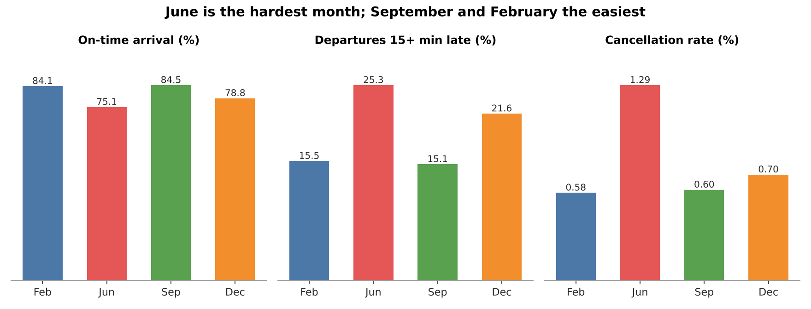
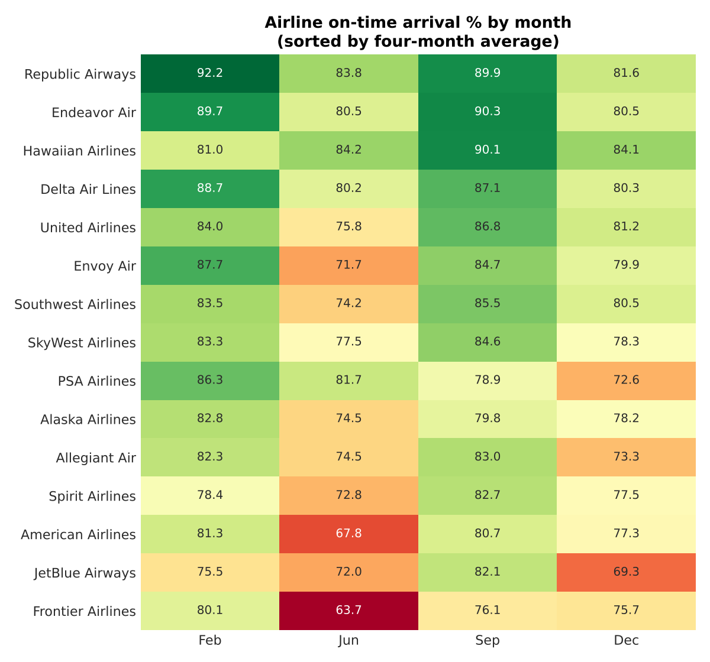
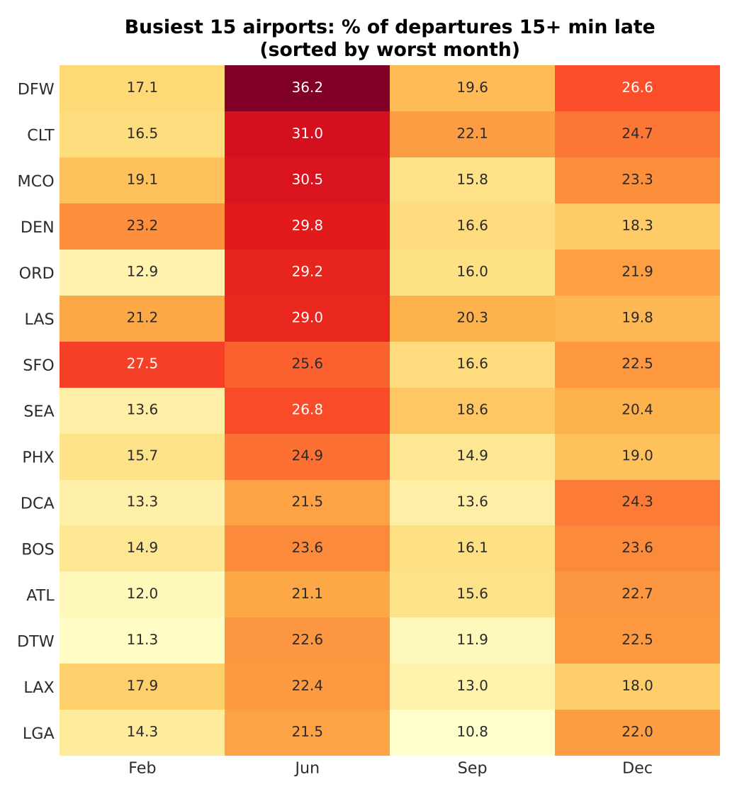

# US Airline Delays: Operational Analysis and Delay Prediction

Analysis of 2.3 million US domestic flights from the Bureau of Transportation Statistics (BTS) Airline On-Time Performance data. The data covers one month from each quarter of 2024 (February, June, September, December) so that all four seasons are represented.

The project loads and cleans the raw data, builds a DuckDB star schema, answers ten business questions with SQL, trains a model that predicts 15+ minute departure delays 60 minutes before takeoff, and presents the results in a five-page Power BI dashboard.

## Key findings

| Measure | Result |
|---|---|
| Flights analysed | 2,303,556 |
| Late departures (15+ min) | 19.6% |
| On-time arrivals | about 80.5% |
| Cancelled | 0.80% |
| Largest delay cause | Late-arriving aircraft, 39.8% of delay minutes |

**Seasons.** June was the hardest month (75.1% on-time arrival, 25.3% late departures) and September the easiest (84.5%, 15.1%). Average departure delay was 2.5 times higher in June than in September.



**Time of day.** Delays build through the day in every season. The late-departure rate at 8pm is 3.4 to 4.8 times the rate at 5am.


**Late aircraft.** When an aircraft's previous flight arrives 15 to 59 minutes late, its next departure is late 50% of the time, against 9% when the previous flight arrived early.


**Airlines and airports.** Republic, Endeavor and Delta stayed in the top six carriers in every month, while American, Frontier and JetBlue stayed in the bottom five. Hubs peak in different seasons: DFW, Charlotte, Orlando, Denver, O'Hare and Las Vegas in June, Atlanta, Washington National and LaGuardia in December, and San Francisco in February.





Full write-up of all ten business questions: [documentation/business_findings.md](documentation/business_findings.md)

## Delay prediction model

Predicts whether a flight will depart 15+ minutes late, 60 minutes before scheduled departure, using only information available at that time.

- **Split:** chronological by whole months. Trained on February and June, validated on September, tested on December, a season the model never saw.
- **Result:** gradient boosting scored ROC-AUC 0.764 and PR-AUC 0.516 on the test month, against a no-skill PR-AUC of 0.216 (2.4 times better). Logistic regression and random forest scored 0.734 and 0.754 ROC-AUC.
- **Leakage controls:** no actual times, arrival delay of the flight itself, taxi times or delay-cause columns. History features use only flights that had already landed or departed before the prediction time.
- **What drives accuracy:** the status of the aircraft's previous flight is the largest gain (ROC-AUC 0.639 to 0.742), and delay rates at the same airport over the previous 3 hours add a further 0.018.
- **Lead time:** accuracy falls from 0.764 at 60 minutes to 0.703 at 120 and 0.682 at 180 minutes, because the inbound aircraft is less often known.

Details: [model_results.md](documentation/model_results.md), [ablation_results.md](documentation/ablation_results.md), [methodology.md](documentation/methodology.md)

## Power BI dashboard

Five pages on the star schema, with 41 DAX measures, a date table and a shared theme: [powerbi/aviation_dashboard.pbix](powerbi/aviation_dashboard.pbix). All visuals were checked against the SQL results.

| Page | Content |
|---|---|
| 1. Executive Overview | Six KPI cards, late departures by month, delay build-up by hour for each season |
| 2. Airline Performance | On-time ranking, airline by month heatmap, delays versus cancellations |
| 3. Airport Performance | Busiest airports by month, highest late-departure rates (500+ departures), airport table |
| 4. Routes and Timing | Most delay-prone routes, day of week, weekday by time-of-day heatmap |
| 5. Delay Causes | Cause mix by airline, overall causes, cancellation reasons, late-aircraft effect |


The report reads the exported Parquet files in `powerbi/data/`. If you clone the repo to a different folder, update the file paths in Power Query (Transform data, then the Source step of each table). Page design and measures: [powerbi/dashboard_spec.md](powerbi/dashboard_spec.md).

## Run it

```bash
pip install -r requirements.txt

# Download one month per quarter of 2024 (existing months are skipped)
python python/00_download_bts.py --year 2024 --quarterly

# Clean, build the warehouse, run all SQL, export for Power BI, train models, summarise, draw charts
python python/run_all.py --with-ablation
```

Other download options: `--month 6`, `--months 2,9,12`, `--months 1-12`. Use `--skip-model` on `run_all.py` to skip model training.

| Step | Script | Output |
|---|---|---|
| 1 | `00_download_bts.py` | `data/raw/*.csv` |
| 2 | `01_clean_flights.py` | `data/processed/flights_clean.parquet`, `documentation/data_quality_report.md` |
| 3 | `02_build_warehouse.py` | `data/processed/aviation.duckdb` |
| 4 | `03_run_sql_analysis.py` | `data/processed/results/*.csv`, `documentation/validation_results.md` |
| 5 | `04_export_powerbi.py` | `powerbi/data/*.parquet` |
| 6 | `05_delay_model.py` | `documentation/model_results.md` |
| 7 | `07_model_ablation.py` | `documentation/ablation_results.md` |
| 8 | `06_summarize_results.py` | `documentation/results_digest.md` |
| 9 | `08_make_charts.py` | `documentation/charts/*.png` |

To test the pipeline without real data, `python python/make_sample_data.py` writes synthetic rows to `data/sample/`. Synthetic data is for testing only.

## Data model

Star schema in DuckDB: `fact_flights` with `dim_airline`, `dim_airport` (origin and destination), `dim_date` and `dim_route`. Schema and load: [sql/01_build_star_schema.sql](sql/01_build_star_schema.sql).

## Definitions

- **On-time:** completed flight arriving less than 15 minutes after schedule (BTS convention).
- **Late departure:** departure 15 or more minutes after schedule.
- **Cancelled and diverted flights** stay in the fact table and are reported separately. Cancelled flights have their actual-performance fields blanked.
- **Delay-cause minutes** exist only for flights arriving 15+ minutes late.

## Repository layout

```
data/raw, data/processed   BTS downloads and cleaned outputs (git-ignored)
python/                    download, cleaning, warehouse, SQL runner, export, model, ablation, charts
sql/                       schema, validation checks, airline, airport, route, seasonal and delay-cause queries
powerbi/                   Power BI report (.pbix), theme, dashboard specification and exported tables
screenshots/               dashboard page images
documentation/             findings, methodology, model results, data quality, charts
```

## Project status

| Phase | Status |
|---|---|
| Data download, cleaning, validation | Done, run on four quarters of 2024 |
| Star schema and SQL analysis (28 queries) | Done |
| Business findings, ten questions, seasonal analysis | Done |
| Delay prediction model and ablation | Done |
| Charts | Done |
| Power BI dashboard (5 pages) | Done, 41 DAX measures ([powerbi/aviation_dashboard.pbix](powerbi/aviation_dashboard.pbix)) |

## Limitations

- Four months of one year. Each month is a snapshot of its season, so month differences combine season with that month's weather and events.
- US reporting carriers and domestic flights only.
- Weather is measured through BTS cause codes. No external weather data is joined.
- Findings describe associations, not causes.
- Rankings of small airports and routes rest on small samples.
